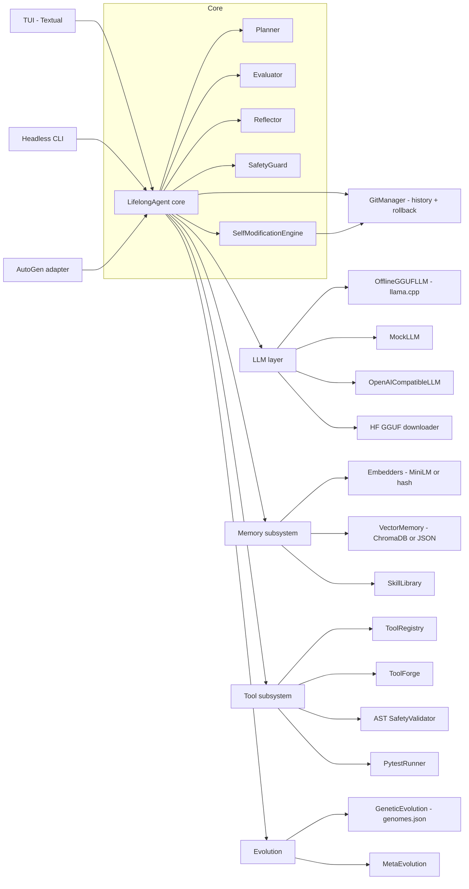
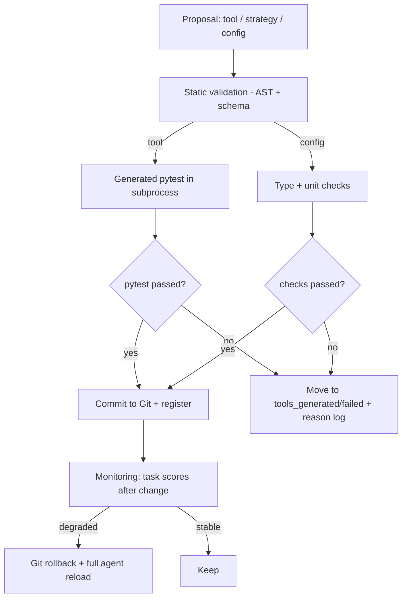
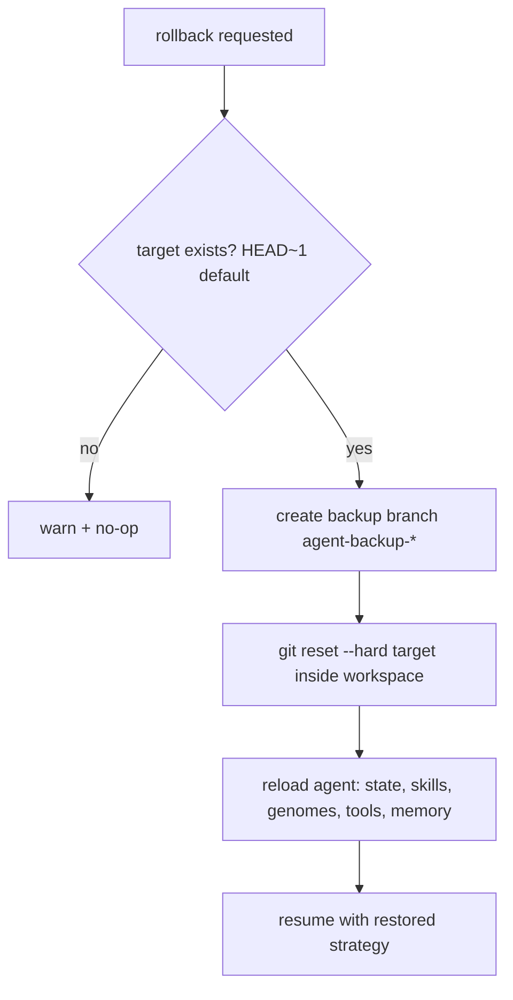

# Architecture

## Component diagram

## Lifelong learning loop

1. **Receive task** — from TUI, CLI, or AutoGen adapter.
2. **Retrieve** — semantic memory search (top-k), skill retrieval, tool listing.
3. **Plan** — `Planner` asks the LLM under the active strategy.
4. **Act** — a relevant registered tool (token-overlap selection) or the LLM.
5. **Feedback** — `Evaluator` scores the result 0..1.
6. **Reflect** — `Reflector` produces a short reflection.
7. **Distill** — successful outcomes become `Skill` entries.
8. **Update strategy** — the task score folds into the active genome's fitness.
9. **Store experience** — full record into vector memory.
10. **Evolve** — every `META_EVOLVE_EVERY` tasks, a genetic step runs and the
    best genome becomes the active strategy (version incremented, history kept).

State (`agent_state.json`), skills (`skill_library.json`), genomes
(`genomes.json`), memories, and tools all persist across restarts.

## Self-modification pipeline

Key invariant: **no generated tool is ever loaded or executed before it passes
AST validation and its generated pytest suite.** The agent never overwrites
core source files; self-modification is limited to tools, strategies
(genomes), and configuration, unless a human explicitly enables
`ENABLE_CORE_SELF_MODIFICATION`.

## Memory architecture

- **Embedders**: `SentenceTransformerEmbedder` (all-MiniLM-L6-v2, 384-d) when
  available, otherwise `HashEmbedder` — a deterministic, hashlib-based
  bag-of-tokens embedder (stable across processes and machines).
- **Vector memory**: `ChromaVectorMemory` (PersistentClient, cosine space)
  when chromadb is installed, otherwise `JSONVectorMemory`
  (`vector_memory_<embedder>.json`) with cosine similarity search.
- **Records** store: task, action, feedback, reflection, score,
  strategy_version, timestamp, tool_usage, metadata.

## Evolution architecture

- **Genome**: id, list of strategy principles, fitness (running mean of task
  scores), tasks, generation, traits (caution, curiosity, tool_usage,
  verification, minimalism, memory_usage).
- **Genetic step**: rank by fitness → keep elites → fill population with
  crossover children (unique principles, capped) → probabilistic mutation
  (add / remove / replace / shuffle principle) → persist `genomes.json`.
- **Activation**: the best genome's principles become the agent's
  `current_strategy`; `strategy_version` increments and is recorded in
  `strategy_history`.

## Git rollback flow

The GitManager refuses to operate outside its workspace, never touches the
filesystem anchor or the home directory, and always creates a backup branch
before a hard reset.
