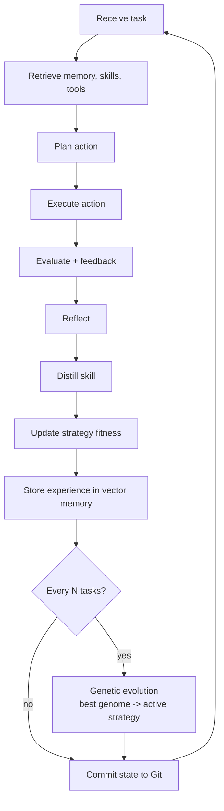

# Lifelong Self-Evolving Offline Agent

A lifelong autonomous agent that **continuously learns, reflects, evolves its
strategy with a genetic algorithm, writes its own Python tools, validates them
with pytest, stores semantic memories, and tracks every self-modification in
Git — with safe rollback to previous states.**

Offline-first: it runs with **zero mandatory dependencies**. Heavy components
(llama-cpp-python, chromadb, sentence-transformers, pyautogen) are optional
and degrade gracefully.

---

## Features

| Capability | Implementation | Fallback |
|---|---|---|
| Offline GGUF inference | `llama-cpp-python` (chat → plain completion) | `MockLLM` (deterministic) |
| Model download | exact `huggingface-cli download tencent/Youtu-LLM-2B --revision GGUF --include "*.gguf" --local-dir Youtu-LLM-2B-GGUF` chain | `python -c` + in-process `snapshot_download` |
| Vector memory | ChromaDB persistent collection | JSON file + cosine similarity |
| Embeddings | local `sentence-transformers/all-MiniLM-L6-v2` | deterministic hash embedder |
| Skill library | ranked, pruned, persisted lessons | — |
| Self-written tools | LLM proposal → safe template fallback | deterministic template |
| Tool safety | AST validation + mandatory generated pytest | rejected tools moved to `tools_generated/failed/` |
| Strategy evolution | genetic algorithm (elitism, mutation, crossover) | persisted `genomes.json` |
| Self-modification history | Git manager inside the workspace | backup branch + `git reset --hard` rollback |
| TUI | Textual (tabs: Log / Skills / Tools / Memory / Git) | headless CLI |
| AutoGen | optional ConversableAgent-compatible adapter | JSON `generate_reply` fallback |

## Installation

```bash
git clone https://github.com/abdulraheemnohri/Lifelong-Agent
cd Lifelong-Agent
pip install -r requirements.txt          # core (light)
pip install -r requirements-optional.txt  # optional heavy backends
pip install -e .
```

## Download the offline model

```bash
python scripts/download_model.py            # default: tencent/Youtu-LLM-2B @ GGUF
HF_TOKEN=*** python scripts/download_model.py   # gated repos
python scripts/download_model.py --force    # re-download
```

This performs (or emulates) exactly:

```bash
huggingface-cli download tencent/Youtu-LLM-2B \
  --revision GGUF \
  --include "*.gguf" \
  --local-dir Youtu-LLM-2B-GGUF
```

The best GGUF file is selected automatically (q4_k_m, q4_0, q5_k_m preferred;
otherwise the smallest reasonable file).

## Usage

TUI:

```bash
python -m lifelong_agent.tui        # or: python scripts/run_tui.py
```

Headless:

```bash
python scripts/run_headless.py --task "Debug a failing Python test"
python scripts/run_headless.py --loop --tasks "task one,task two"
python -m lifelong_agent.main --backend mock --task "count words"
```

Rollback:

```bash
python scripts/rollback.py            # back to HEAD~1, then reload agent state
python scripts/rollback.py --commit <sha>
```

Docker sandbox:

```bash
docker compose up --build
```

## Testing

```bash
pip install -r requirements.txt -r requirements-dev.txt
pytest
```

The suite runs **fully offline**: no internet, no GPU, no GGUF model.
It uses `MockLLM`, the hash embedder, JSON vector memory, and temp
workspaces. CI runs the suite on Python 3.10/3.11/3.12 via GitHub Actions.

## Configuration

Everything is configurable through environment variables — see
`config.example.yaml` and [USAGE.md](USAGE.md) for the full list
(`LLM_BACKEND`, `EMBEDDER_BACKEND`, `VECTOR_BACKEND`, `POPULATION_SIZE`,
`META_EVOLVE_EVERY`, `SUCCESS_THRESHOLD`, ...).

## Lifelong loop



## ⚠️ Safety warning

Generated tools are **statically validated (AST) and pytest-tested before
loading**, and dangerous imports/calls/attributes are banned — but **AST
validation is not a full sandbox**. For production use, run the agent inside
a container sandbox (Docker/Podman/gVisor/Firecracker). The included
`Dockerfile` / `docker-compose.yml` provide that sandbox. See
[SAFETY.md](SAFETY.md).

## Documentation

- [ARCHITECTURE.md](ARCHITECTURE.md) — components, pipelines, rollback flow
- [SAFETY.md](SAFETY.md) — threat model, sandboxing, production checklist
- [USAGE.md](USAGE.md) — CLI commands, TUI controls, troubleshooting
- [docs/](docs/) — deployment, extension guide, production checklist

## License

MIT — see [LICENSE](LICENSE).
